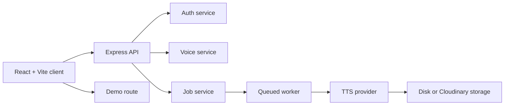

# VerseVoice

VerseVoice is a free-tier voice-poetry app that lets a user record a voice sample once, paste a poem, and generate spoken audio in that voice. It also includes a no-signup demo flow using preset voices.

## Features

- Record and upload a personal voice sample
- Generate audio from poetic text with pause handling and line-gap controls
- Support a public demo route using preset voices with quota limits
- Process jobs asynchronously with a worker and storage abstraction
- Keep the server in local-memory mode or MongoDB-backed mode

## Architecture

## Stack

- Client: React 18, TypeScript, Vite
- Server: Node 22, Express, TypeScript, ESM, tsx
- Data: MongoDB or in-memory maps
- Files: local disk or Cloudinary
- TTS: mock provider, cloud provider, and external XTTS-compatible service
- Tests: Node test runner for server

## Local run

1. Install dependencies:
   `npm install`
2. Create local environment files from the examples:
   In PowerShell, run `Copy-Item server/.env.example server/.env` and `Copy-Item client/.env.example client/.env`.
   Change the example `JWT_SECRET` before deploying. Local `.env` files are ignored by Git.
3. Start the server:
   `npm run dev`
4. Start the client in another terminal:
   `npm --workspace client run dev`
5. For mock-mode development, keep the default demo provider and safe local config.

## Environment summary

| Variable | Purpose |
| --- | --- |
| PORT | Server port |
| CLIENT_ORIGIN | Allowed CORS origin |
| JWT_SECRET | JWT signing secret |
| DB_MODE | `memory` or `mongo` |
| MONGODB_URI | MongoDB connection string |
| STORAGE | `local` or `cloudinary` |
| PUBLIC_BASE_URL | Public base URL for uploaded files |
| TTS_PROVIDER | `mock`, `cloud`, `xtts`, or `auto` |
| DEMO_DAILY_LIMIT | Demo quota |
| USER_DAILY_LIMIT | Logged-in quota |
| GLOBAL_DAILY_CLOUD_CAP | Daily cloud usage cap |

## Testing

Run the server suite:

`npm --workspace server test`

Run the TypeScript check:

`npm --workspace server run typecheck`

## Design notes

- The layers are intentionally separated: routes -> services -> repos/providers.
- The quota system rejects invalid input early and caps free-tier usage in code.
- The worker ensures asynchronous generation while keeping the API responsive.
- Local mock providers are used for development and deterministic tests.

## Limitations

- Free-tier external services can sleep or rate-limit requests.
- Production setup requires valid secrets and a reachable storage provider.
- XTTS and cloud TTS services depend on external infrastructure and provider limits.

## Resume-ready summary

- Built a full-stack voice-generation app with auth, storage, quotas, and async workers.
- Designed a resilient, free-tier-friendly backend with test-first validation.
- Delivered a monorepo project structure ready for local development and deployment.
